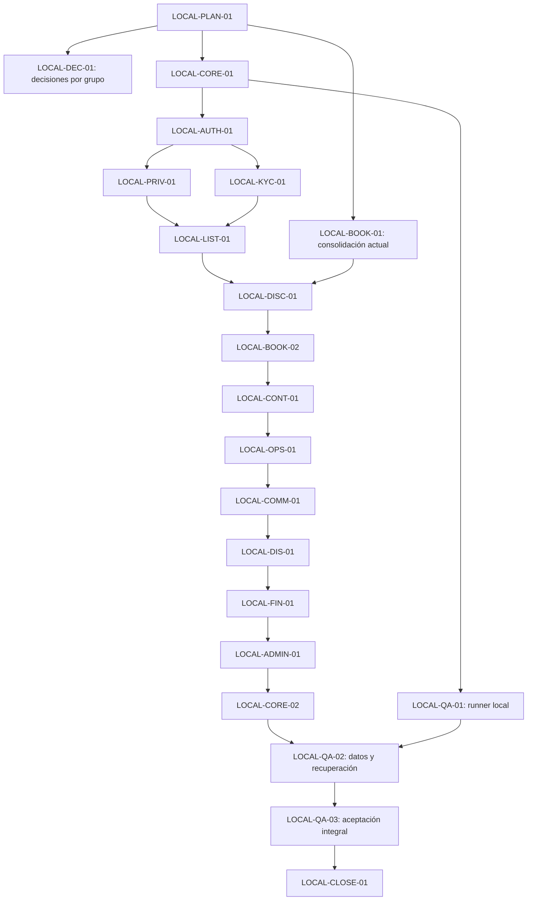

# Plan de cierre del desarrollo local del backend

Fecha inicial: 2026-10-07. Línea base conciliada para LOCAL-QA-01: PR #237 merge `09f03f60061ebd3dacb679661ad0180e5901b054` (2026-10-10), aceptación local de #236 registrada y V44/V45 aplicadas incrementalmente al volumen de desarrollo. Las líneas base anteriores se conservan en el historial de Git.

Actualización funcional (2026-10-09): tras los merges #211/#213, `main` integra publicación local y su conexión a búsqueda/detalle/cotización. #212 quedó aceptada como slice sin cerrar M04/M05. LOCAL-BOOK-02 (#214, hija de #73 y relacionada con #75/#77) consolida reserva, pago fake y decisión sobre una publicación activa sin fixture habilitado, reutilizando eventos durables, snapshots, ocupación y `local_flexible_v1`. Evidencia: [LOCAL-BOOK-02](evidence/local-book-02-20261009.md). Los padres siguen abiertos por criterios generales y proveedor real.

Actualización conciliada al 2026-10-11: PR #245 (`74b10dbe655d4f6ae3957a6de81f895ab887e57d`) integra LOCAL-QA-03 y PR #254 (`1b57df27f6991833cc73f3bdf7479a5ecea2c704`) integra LOCAL-CLOSE-01D. #244 y #250 fueron aceptadas/cerradas/Hecho únicamente por sus alcances; #246 sigue abierta hasta la aceptación final del propietario. La matriz se actualizó tras aceptar #250 y ejecutar el runner integral actualizado; véase [`evidence/local-close-01-matrix-20261011.md`](evidence/local-close-01-matrix-20261011.md) y la nueva evidencia final LOCAL-CLOSE-01. #185/#40, #109/#110 y #111–#118 conservan criterios generales incompletos.

Actualización posterior a PR #263 (2026-10-11): `main` integra `a0a3ad6130745d3d2126eb4c1c92805eacc39084`; #258 se aceptó por RQF-091/092 y #259 por RQF-177, ambas cerradas/Hecho solo por sus slices. V50/V51 se aplicaron incrementalmente al entorno persistente y `verify-http` pasó. Las pruebas enfocadas de eliminación y cierre de reservas pasaron en PostgreSQL desechable.

LOCAL-CLOSE-01E implementa la exportación propia de contratos y la retención sintética ratificada para contratos e historiales de publicación/eliminación. La adaptación owner-store especializada de MAP-02/DB02-02 queda ratificada para LOCAL-1: cada documento conserva un único recurso propietario, autorización, almacenamiento privado y limpieza recuperable; no se reestructura el almacenamiento global ni se modifican ES1/ES2. Los contratos, firmas e historial/PDF se conservan hasta el último cierre terminal relacionado + 24 meses calendario, salvo obligaciones abiertas; historial de publicación/eliminación, 24 meses desde la eliminación definitiva, salvo obligaciones pendientes. Consultas, reintentos y exportaciones no reinician fechas.

El commit funcional probado es `e8c49427909bd610a7a4e4137c546090f5352b72`, basado en `main` #265 (`6358b26cc891977b8503f96bece033d34ebc631b`). La regresión completa `bash scripts/test-local-qa.sh` pasó en ese commit: 100/100 pruebas del mock, 4/4 controles del gate, `go test -p 1 ./...`, `go vet ./...`, 86/86 integraciones obligatorias (124 eventos Go), cero omitidas/SKIP y 5/5 repeticiones de check-in. Migración V52→V53, aislamiento del ZIP y retención/cleanup también pasaron en PostgreSQL desechable. No se aplicó V53 al volumen persistente; volumen, secretos y datos locales permanecieron intactos. La evidencia detallada está en [`evidence/local-close-01-contract-export-20261011.md`](evidence/local-close-01-contract-export-20261011.md).

No quedan brechas funcionales locales obligatorias identificadas para LOCAL-1. #246 permanece abierta hasta la integración/revisión de esta entrega y la aceptación explícita del propietario. Los Issue padres siguen abiertos por criterios generales/productivos que exceden LOCAL-1; no se reinterpretan como brechas locales ni se cierran por sus slices. No hubo trabajo de GCP.

La guía de arranque y conciliación final están en [`guia_arranque_local.md`](guia_arranque_local.md), [`matriz_cierre_backend_local.md`](matriz_cierre_backend_local.md) y [`trazabilidad_requisitos_backend_local.md`](trazabilidad_requisitos_backend_local.md). La evidencia de runner se reutiliza para `e8c4942`; el mismo commit además tiene pruebas enfocadas de contratos/retención. No se repitió la regresión después de cambios exclusivamente documentales.

**Objetivo autorizado:** terminar el alcance funcional local de M01–M11, con PostgreSQL, Backend, API, pruebas y un mock mínimo por módulo. GCP se propondrá únicamente después de aceptar ese cierre. Este plan fue inicialmente documental; esta instrucción habilita el desarrollo por entregas verticales.

## 1. Autoridad y documentos de trabajo

- Instrucción del usuario del 2026-10-07 y `planificardesarrollo.md`: planificación primero; prioridad DB → Backend → API → pruebas → mock.
- `vision_y_modulos.md`, referencias ES1/ES2, contratos y decisiones ratificadas: alcance y reglas. ES1 permanece inmutable.
- GitHub Issues y [Project EspaciGo — Desarrollo](https://github.com/users/HernanEspinozaDev/projects/1): registro operativo. Los estados del backlog antiguo y las guías anteriores son históricos cuando difieran del registro actual.
- [Backlog de cierre local](backlog_cierre_backend_local.md): paquetes propuestos, dependencias, aceptación y validaciones por módulo. LOCAL-KYC-01 (#200) fue aceptada tras PR #201; LOCAL-M02-01 está representada por la Issue #202. Otros IDs siguen siendo paquetes de planificación, no Issues o autorizaciones por sí solos.
- [Evaluación anterior del alcance](alcance_backend_local_y_transicion_gcp_20261007.md): inventario de partida. Su alternativa de probar GCP antes de completar todos los módulos queda sustituida por este plan.

No reabrir ni duplicar entregas aceptadas para volver a hacer lo mismo. Contrastar cada criterio con código, PR fusionado y evidencia. Una subentrega aceptada no demuestra todos los criterios de su Issue general.

## 2. Qué se considera backend local completo

El objetivo comprende **el comportamiento de negocio completo del alcance acordado**, sobre datos sintéticos. Se deben poder ejecutar los casos de uso locales con cuentas de distintos roles, desde creación de cuenta hasta cierre del arriendo, privacidad y administración.

Las acciones generales de negocio deben funcionar sobre entidades creadas mediante las APIs autorizadas. Los scripts de fixtures sirven para preparar pruebas; una allowlist de un único espacio o pareja no debe sustituir el modelo general de publicación, elegibilidad, búsqueda o reserva. Se conserva un perfil de desarrollo explícito para los fakes y herramientas de ensayo.

| Se completa ahora, en local | Se conserva para una fase posterior |
| --- | --- |
| Dominio y persistencia de los once módulos; estados, ownership, transacciones y autorización. | Infraestructura, despliegue, pruebas, rendimiento y operación en GCP. |
| Contratos HTTP/JSON, OpenAPI y comportamiento de los adaptadores externos mediante fakes verificables. | Proveedor real/sandbox, firma y contrato de webhooks del tercero, credenciales reales y validación de entrega externa. |
| Intenciones, eventos, reintentos, resultados y conciliación durables simulados. | Cobros, devoluciones, garantías, liquidaciones y documentos tributarios con efectos reales. |
| Documentos sintéticos privados, finalidades y procedimientos locales de privacidad trazados. | Documentos personales reales, validación jurídica y afirmaciones de cumplimiento legal o identidad verificada real. |
| Pruebas locales reproducibles, recuperación, actualización, backup/restore aislado y mock por módulo. | Certificación de SLA, capacidad, HA, RPO/RTO o seguridad de la futura plataforma cloud. |

Un resultado fake debe estar identificado como simulado en datos, respuestas y mock donde pueda confundirse con uno real. El dominio no puede depender de que el proveedor sea fake; se selecciona mediante un adaptador. No habilitar proveedores ni recibir documentos personales reales con esta planificación.

### Condición de cierre LOCAL-1

1. Cada RQF/CU aplicable y RNF verificable localmente está conciliado: implementado y probado, cubierto mediante simulación explícita, o excluido mediante decisión trazable. No basta contar Issues cerradas.
2. Los once módulos tienen sus operaciones locales completas, integración entre módulos y criterios de aceptación satisfechos. No quedan criterios funcionales locales obligatorios pendientes de decisiones.
3. Las 43 entidades lógicas del Anexo B están conciliadas una por una con el modelo efectivo: estructura local equivalente, brecha concreta, decisión pendiente o exclusión/diferimiento ratificado. No se exige crear 43 tablas físicas ni usar nombres globales en el prototipo; la correspondencia explica los owners y estructuras especializadas.
4. Se reconstruye el sistema desde una base vacía y se actualiza una base anterior con datos, sin alterar migraciones aplicadas ni perder información que deba conservarse.
5. Los recorridos principales y alternativos funcionan con autorización, errores, idempotencia y concurrencia; las integraciones PostgreSQL requeridas no se omiten.
6. Los once módulos se comprueban desde el mock temporal. Su código usa HTML/CSS/TypeScript compilado, DOM y `fetch`; contenedor propio, sin acceso directo a DB.
7. Reinicios, reintentos y fallos simulados no duplican mensajes, pagos, firmas, movimientos, notificaciones ni transiciones. Los workers recuperan su trabajo pendiente.
8. La evidencia identifica commit, comando, escenario, resultado y limitación. Un comando/documento de arranque permite reproducir el recorrido en el PC.
9. Las Issues generales con obligaciones externas siguen abiertas o con seguimientos explícitos. El cierre local no se declara cierre del producto global.
10. El propietario acepta el cierre local tras revisar el PR final de consolidación. Solo entonces podrá proponerse una planificación distinta para GCP.

## 3. Punto de partida y cierre de cada módulo

Esta tabla expresa trabajo por planificar, no nueva evidencia de implementación.

| Módulo | Base existente que se reutiliza | Resultado local que falta completar | Referencias originales |
| --- | --- | --- | --- |
| M01 Identidad | Registro, términos, verificación Mailpit, sesiones, recuperación/cambio, preferencia independiente, historial de clave y outbox V22/V27/V46. | RQF-016 ya está cubierto localmente por aviso durable de bloqueo y Mailpit en #247/PR #251; se conserva la limitación SMTP de posible duplicado ante una respuesta incierta. | #26–35; CU-01–06/50; RQF-016, 213/217/218. |
| M02 Perfil/privacidad | Perfil/solicitudes, ZIP, baja/replay; foto sintética privada y cuenta de cobro fake con gate KYC local. | #248/PR #252 aceptada con V47: aplica los plazos ratificados de metadata/blob KYC, cotizaciones no convertidas, aceptaciones y solicitudes resueltas, con borrado recuperable de archivos y referencias. La ubicación de copias no comprobadas permanece acotada; no afirmar supresión integral. | #36–43; CU-07–09; #185/#40. |
| M03 Verificación | Casos/revisión/reintento sintéticos y storage privado PNG aceptados. LOCAL-KYC-01 (#200) integra historial/elegibilidad con baja y gates. | Aviso durable local de resultados KYC/KYB RQF-047/194 aceptado en #247. #248/V47 aplica la retención/purga local. Documentos/RUT/proveedor y reglas productivas siguen en #142. | #44–51; CU-10–14; RQF-047/194; #142 conserva obligaciones reales. |
| M04 Publicaciones | Borradores, ocho categorías, atributos versionados, tarifas, zona, calendario, publicación/ocultamiento/reactivación owner-only V31, edición individual, galería privada sintética y conexión de ofertas activas al catálogo M05 aceptados por slices (#204–#212). | Siguen pendientes reglas comerciales amplias y criterios generales de publicación de #52–61; no falta el ciclo local básico. El calendario sigue siendo `ocupacion` de M06. | #52–61; CU-15–18. |
| M05 Descubrimiento | Catálogo sintético, filtros, geografía, paginación, selector y snapshots implementados; #212 aceptada; LOCAL-BOOK-02 usa la oferta activa. | Criterios comerciales generales, escala/performance y restantes #62–68 siguen abiertos. | #62–68; CU-19–21. |
| M06 Reservas/pagos | Retenciones, pago/refund fake durable, inbox, conciliación, cancelación y bandeja; LOCAL-BOOK-01 (#177), LOCAL-BOOK-02 (#214) y LOCAL-FIN-01 (#224) aceptadas solo por sus cortes locales. V40 aplicada después del merge #225. | Avisos durables de pago aprobado/rechazado y solicitud pagada (RQF-121/122/201) aceptados localmente en #247. Proveedor real/sandbox y criterios generales #69/#73/#75/#77/#79 siguen como pendientes separados. | #69–79; CU-22–28/47/51. |
| M07 Contratos | LOCAL-CONT-01 (#216) aceptada: snapshot/versiones, documento privado cifrado, firmas/rechazo fake por participante, vencimiento y cancelación transaccional con devolución. | Invitaciones locales por firmante y aviso durable tras ambas firmas (RQF-134/135/139) aceptados en #247. Proveedor de firma y validez jurídica permanecen externos/excluidos. | #80–87; CU-29–32. |
| M08 Operación | LOCAL-OPS-01 (#218, aceptada/Hecho tras merge #219) añade check-in/out/recepción, evidencia privada sintética, reloj/actor, mensaje durante `en_curso` y transición a reclamo/descargo limitada. | #249 aceptada localmente tras PR #253: PNG sintético privado en descargo, autorización por reserva, exportación acotada, baja y purga recuperable. No requiere fotos reales ni proveedor externo. | #88–94; CU-33–34/48; M10. |
| M09 Comunicación | Chat idempotente/paginado, cursores, reseñas recíprocas, moderación y avisos ratificados de check-in, reporte, reclamo abierto/resuelto y cancelación aceptados en #156/#158/#220 y V38. No realtime ni aviso por mensaje. | Avisos locales ratificados por productor aceptados en #247, además del corte de reseñas/moderación #220. Módulo general sigue parcial por criterios padre. | #95–102; CU-35–38/49. |
| M10 Disputas/cierre | LOCAL-OPS-01/#218 conserva apertura/descargo; LOCAL-DIS-01/#222/#223 implementa evidencia privada y adjudicación local; LOCAL-FIN-01/#224/#225 agrega garantía y deducción/captura/liberación fake. LOCAL-FIN-SETTLEMENT-01/#236 integra liquidación fake. | RQF-210 está satisfecho con trigger V38 y los avisos enumerados en #247; RQF-165 aceptado localmente en #249/PR #253 con evidencia sintética privada de descargo. No añade adjudicación. #248 purga retenciones sintéticas independientes. Documento fiscal y cualquier operación real están fuera. | #103–110; CU-39–42. |
| M11 Administración | Rol/auditoría base y LOCAL-ADMIN-01A/B/C/D (#226/#228/#233/#235) aceptadas por cortes; bloqueo, tres reportes ratificados, lectura/export auditada y auditoría transaccional financiera. | LOCAL-ADMIN-01D/#250 aceptada/Hecho tras PR #254: búsqueda exacta por UUID, lista/detalle de publicaciones activas y agregado de disputas; auditoría mínima y limpieza de respuestas/sesión. Otros reportes no especificados se difieren. No se crea plataforma genérica de eventos. | #111–118; CU-43–46/52 permanecen abiertos por criterios generales. |

Los rangos de RQF/HU/RNF se mantienen en `vision_y_modulos.md` y anexos; las tarjetas de ejecución deben citar los IDs particulares afectados. No se inventan criterios para cerrar los rangos.

## 4. Decisiones pendientes: resolverlas por módulo

El primer paquete prepara una tabla de decisiones con fuente, recomendación, alternativa, efecto sobre DB/API y criterio bloqueado. Se consultan juntas las decisiones de producto relacionadas; las decisiones técnicas rutinarias dentro de contratos aprobados no requieren una aprobación adicional por comando.

| Grupo | Decisión necesaria antes de la parte dependiente | Tratamiento recomendado en el plan |
| --- | --- | --- |
| D-AUTH | Preferencias, historial y avisos de credenciales. | **Ratificada e implementada para el alcance local:** preferencia no excluyente separada de roles; hashes anteriores se conservan por ventana calendario de tres meses desde que dejan de estar vigentes; aviso de cambio transaccional/durable y sin secretos. V22/V27 aceptadas en #183/#199. Correo productivo y criterios restantes de #31/#34 continúan pendientes. |
| D-PRIV | Exportar, minimizar/retirar y conservar cada grupo de datos. | `privacidad_local_v1` y el plazo sintético de contratos/publicaciones/eliminaciones ratificados por el propietario. LOCAL-CLOSE-01E exporta contratos propios minimizados y purga grupos al vencer sin reiniciar fechas; la baja informa retención residual, no anonimización. Copias no comprobadas permanecen fuera del inventario acotado. |
| D-KYC/LIST | Alcance de aprobación/revocación y el tipo de verificación exigido por cada operación. | **Ratificado e implementado para cuentas personales sintéticas:** KYC aprobado habilita nuevas publicaciones/reservas que lo exigen; KYB no sustituye KYC y no se exigen ambos. Elegibilidad persiste por tipo hasta revocación administrativa auditada; bloquear no cancela reservas. No concede roles. #142 mantiene documentos/RUT/proveedor reales fuera. |
| D-BOOK | Políticas locales de tarifa/comisión, garantía, cancelación y transición entre módulos. | Reutilizar snapshots y `local_flexible_v1` ya aceptada; ratificar solo brechas nuevas. Ninguna política local adquiere efectos financieros reales. |
| D-CONT/OPS | Plantilla y firmantes; ventanas de entrega/recepción, objeción y vencimiento. | Contratos y documentos sintéticos; estados explícitos y reloj inyectable. LOCAL-CLOSE-01E exporta snapshot, firmas/historial minimizados y PDF disponible. La firma fake no demuestra validez jurídica; aplicación productiva y firma jurídica siguen excluidas. |
| D-COMM | Ratificada para LOCAL-COMM-01, solo datos y operaciones sintéticas locales. Una reseña por participante/reserva finalizada; 1–5 entero obligatorio, comentario opcional, sin edición/ventana adicional y sin altas en disputa. Reporte estructurado del anfitrión marca reportada sin ocultar ni afectar promedio; admin desestima/oculta con motivo y auditoría. Avisos transaccionales Mailpit para check-in, reporte, apertura de reclamo y cancelación; ocho intentos/ciclo, fallo terminal/reapertura admin; SMTP puede duplicar con resultado incierto. Privacidad: reseña 24 meses desde creación, reporte pendiente + 24 meses desde resolución, outbox terminal 30 días; no son plazos legales. Conversación conserva su política. | Implementación DB/API/mock y pruebas en #220; no añadir push, perfil público de arrendatario ni avisos por mensaje. Proveedor externo, criterios generales M09/M08/M10 y políticas productivas permanecen pendientes. |
| D-DIS/ADMIN | Ratificada: decisión de reclamo local independiente de operación monetaria. Para LOCAL-FIN-01 también ratificada `garantia_local_fija_v1` CLP 50.000, autorización posterior al pago fake, plazos/gates, deducción 0..autorizado, requisitos de evidencia/motivo, captura/liberación, cierre a 24h de checkout, retención por reclamo abierto y cancelación/conciliación. | Solo fake sintético: no proveedor ni movimiento real. Pagos del arriendo, garantía y deducción no se mezclan. |
| D-FIN-SETTLEMENT | Ratificada para #236: elegibilidad tras checkout+24h, reserva finalizada, sin disputa/devolución/obligación pendiente; neto de pagos arriendo fake confirmados menos devoluciones confirmadas y comisión versionada `liquidacion_local_0pct_v1` 0 bps. Intención durable, operación única, incertidumbre conciliable, comprobante JSON `comprobante_ensayo` con aviso no fiscal. Una reserva finalizada con snapshot local y saldo positivo también bloquea baja/purga antes de la intención; se eliminan solo los vínculos de actor de sus historiales financieros al vencer retención. | La regla es solo para sintéticos locales. No completa proveedor/liquidación real, comisión productiva, documento fiscal válido ni padres #109/#110. Privacidad aplica exportación, bloqueo de baja/purga ante la obligación, minimización de actor en los historiales financieros y retención de transacciones ya ratificada; sin afirmación de anonimización. |

**Un grupo abierto bloquea solamente su criterio dependiente.** Preparar diseños, implementar reglas ya ratificadas y avanzar módulos independientes sigue siendo posible. Un módulo no se declara completo mientras retenga una decisión obligatoria abierta.

Campañas, promociones, `campana`, `orden_promocion`, `derecho_reporte` y NPS (`respuesta_nps`) continúan diferidos por MAP-07. RQF-183/RQF-236 y RNF-018/026/029 se conservan como referencias cuando apliquen; CU-52/HU26–HU27 describen administración sin habilitar campañas locales, mientras HU24/HU29 siguen sin RF autorizado. Este corte registra la exclusión para revisión, pero no declara esos requisitos implementados/satisfechos ni crea productores, permisos o retenciones para ellos. Favoritos, centro de ayuda y nuevas estadísticas tampoco se incorporan sin requisito vigente.

## 5. Secuencia de entregas

| Hito | Paquetes del backlog local | Resultado revisable |
| --- | --- | --- |
| L0 — Conciliar y cerrar brechas conocidas | LOCAL-PLAN-01, LOCAL-DEC-01 y LOCAL-BOOK-01 fueron aceptados en sus cortes. | LOCAL-CLOSE-01E resuelve exportación de contratos, adapta explícitamente owner-stores y ratifica vencimientos sintéticos. No modifica fuentes académicas congeladas. |
| L1 — Fundamentos y confianza | LOCAL-CORE-01, LOCAL-QA-01, LOCAL-AUTH-01, LOCAL-PRIV-01, LOCAL-KYC-01. | Persistencia general, storage privado, auditoría/outbox base; identidad y derechos completos; verificación sintética que alimenta elegibilidad. |
| L2 — Oferta y reserva generales | LOCAL-LIST-01, LOCAL-DISC-01, LOCAL-BOOK-02. | Publicación local → búsqueda → cotización → reserva → pago fake/cancelación, usando APIs de negocio y no solo habilitadores de fixtures. |
| L3 — Ejecutar y terminar el arriendo | LOCAL-CONT-01, LOCAL-OPS-01, LOCAL-COMM-01 (#220), LOCAL-DIS-01 (#222) y LOCAL-FIN-01 (#224) aceptadas en sus cortes locales. | Firma simulada → entrega/recepción → reseñas/reportes y avisos durables locales → evidencia, descargo, adjudicación y efectos de garantía fake separados. M08/M09/M10 generales siguen parciales. |
| L4 — Resolver y administrar | LOCAL-DIS-01/#222, LOCAL-FIN-01/#224, LOCAL-ADMIN-01A/#226, 01B/#228, 01C/#233, LOCAL-DIS-TEST-MOCK-01/#230, LOCAL-ADMIN-01D/#235 y LOCAL-FIN-SETTLEMENT-01/#236 aceptadas en sus alcances. | LOCAL-QA-01/#238 aceptada por PR #239; el runner reproducible y la estabilidad de check-in están integrados. LOCAL-CORE-02/#240 aceptada por PR #241 y su continuidad local de workers. LOCAL-QA-02/#242 quedó aceptada por PR #243 para migración/actualización/restauración aisladas. #109/#110 conservan proveedor real, comisión productiva y documento fiscal válido; #111–#118 siguen abiertos por criterios generales. #185/#40 permanecen abiertos. |
| L5 — Aceptar backend local completo | LOCAL-QA-02/#242 y LOCAL-QA-03/#244 aceptadas por sus alcances; #246 espera aceptación explícita. | QA-02 cubrió actualización/restauración aisladas y QA-03 sus recorridos del manifiesto. LOCAL-CLOSE-01E aporta exportación contractual y retención. El runner integral y pruebas enfocadas pasan sobre `e8c4942`, V53 incluida en pruebas desechables. No se aplicó V53 al volumen persistente. Se presenta LOCAL-1 para aceptación, sin cerrar Issue padres ni iniciar GCP. |

Los hitos ordenan prioridades; las dependencias reales del backlog permiten trabajo independiente dentro de ellos. No se necesita esperar a terminar toda M11 para usar su infraestructura base de auditoría, ni a un proveedor para probar el dominio con un fake.

### Corte L0 histórico ya aceptado: LOCAL-BOOK-01

Revisar en una sola entrega qué criterios locales ya satisfacen #73 y #75; registrar la separación de alcance de #77 con dependencias de código aceptadas. Conservar los bloqueos y criterios generales de las Issues originales.

- Observar `23P01` directamente en una prueba de la restricción PostgreSQL de solape.
- Comprobar que el servicio/API devuelve el conflicto previsto, sin exponer SQLSTATE al consumidor ni dejar datos parciales.
- Crear dos reservas reales adyacentes `[10:00,11:00)` y `[11:00,12:00)` del mismo espacio y confirmar ambas ocupaciones; comprobar que un solape estricto falla.
- Usar transacciones/control de bloqueos y reloj, PostgreSQL desechable y rol runtime. No cambiar migraciones si las actuales satisfacen la restricción.
- Publicar un único PR con matriz/evidencia actualizada; no tres PRs documentales previos para #73/#75/#77.

Antes de iniciar, registrar la subentrega local y sus relaciones en Projects: #77 conserva dependencias generales abiertas en #75 → #73 → #65. No ignorarlas ni cerrarlas solo para ejecutar pruebas de capacidades locales ya integradas.

## 6. Forma de trabajo para reducir ciclos de revisión

1. Trabajar por **entregas verticales finitas** de un módulo o integración; reutilizar tarjetas originales y abrir subentregas solo cuando un padre mezcle alcance local con externo.
2. En la misma entrega incluir diseño necesario, migración incremental, Backend, API, pruebas relacionadas, mock y documentación. No abrir PRs solo para cambiar cada estado.
3. Revisión humana de un PR por entrega. Publicar commits/push y PR revisable con HernanMEC; si falta aceptación, publicar Draft con pendientes. HernanEspinozaDev aprueba y fusiona.
4. Aplicar pruebas enfocadas durante cambios de lógica; ejecutar regresión e integración necesarias al completar la entrega. Las invariantes de dinero, autorización, concurrencia y pérdida de datos se prueban en la entrega que las introduce.
5. No repetir suite completa ni preflight de herramientas por cambios solo documentales. Reutilizar evidencia del mismo código e indicar su commit y alcance.
6. Una tarea final de mock por módulo, con las operaciones del backlog. No crear una tarjeta por endpoint ni mejorar diseño visual.
7. Actualizar Issues y Project con comentario de merge/evidencia; actualizar matrices en el PR de trabajo o el siguiente PR pertinente. No considerar `Listo` autorización de tareas fuera del alcance ratificado.
8. Mantener bloqueados únicamente criterios que dependan realmente de otra entrega/decisión. Si un padre mezcla obligaciones externas, registrar alcance local hijo y dependencia correspondiente sin borrar la relación general.

## 7. Base persistente y entorno de pruebas

- Desarrollo: PostgreSQL/PostGIS local en Compose, `espacigo_pgdata` persistente, credenciales sintéticas en `.local/secrets` ignoradas, datos conservados entre ejecuciones. Arranque documentado equivalente a `bash scripts/dev-env.sh up -d`.
- Actualizaciones: nuevas migraciones forward; checksums de las anteriores intactos; preservación de los datos locales salvo procedimiento explícito de privacidad o limpieza puntual autorizado.
- Pruebas: otra base/entorno desechable, DSN explícito y rol runtime. Limpieza solo de recursos identificados de pruebas; nunca `down -v` sobre el proyecto persistente de desarrollo.
- Mock: contenedor propio; HTTP/API con autenticación y permisos vigentes; Mailpit para correo local. No extraer tokens desde logs ni conectar el navegador directamente a DB.
- Archivos: almacenamiento local privado con metadata en DB y acceso autorizado por API; validación de tipo/tamaño/hash para fixtures sintéticos conforme al contrato aprobado.
- Se mantienen autenticación, ownership, hashes, idempotencia, permisos y aislamiento existentes. No añadir WAF, IAM cloud, multi-región o hardening productivo como requisitos para terminar un módulo local.
- #123 (limpieza pendiente del servidor) se sigue aparte y no bloquea entregas del PC. No declarar esa limpieza realizada sin verificarla en su host.

## 8. Pruebas previstas para cierre, exclusivamente locales

La planificación no ejecutó estas pruebas.

| Nivel | Momento | Resultado exigido |
| --- | --- | --- |
| Unitarias y contrato | Cambio de dominio/API y cierre de entrega. | Estados, errores, solicitudes/respuestas OpenAPI, rechazo de datos inválidos y reloj determinista. |
| PostgreSQL | Cierre de cada entrega persistente. | Migraciones, ownership, constraints, permisos runtime, integridad, idempotencia y concurrencia; integraciones requeridas ejecutadas, no `Skip`. |
| Mock | Fin del módulo o cambio de comportamiento. | Operaciones de la tarjeta final, errores HTTP, permisos, sesión, selección y respuestas tardías; HTML seguro como texto, sin framework. |
| Integración entre módulos | Hitos L2–L4. | Snapshots, transiciones, efectos atómicos, outbox y contratos; fakes con estados/fallos observables. |
| Recuperación y datos | L4–L5. | Reinicio de procesos/workers; replay y leases; actualización con datos; backup y restauración en destino aislado. |
| Recorrido integral | L5. | Flujo feliz y alternativas: rechazo, expiración, cancelación, objeción, disputa y resolución; distintos actores y una tercera cuenta sin acceso. |
| Rendimiento local | L5, conjunto sintético acotado. | Documentar dataset, máquina y consultas; límites/paginación e índices razonables. No extrapolar a SLA ni a capacidad GCP. |

LOCAL-QA-01 (#238) ofrece `bash scripts/test-local-qa.sh`: mock (npm ci/build y pruebas), suite Go sin DSN persistente, `go vet`, integraciones obligatorias por paquete contra PostgreSQL/PostGIS + Mailpit desechables, gate por manifiesto (ausente/SKIP/fail = fallo) y repetición del check-in intermitente. No toca `espacigo_pgdata` ni secretos. Los workflows alojados, si se añaden para ejecutar ese mismo contrato, no despliegan ni prueban GCP y no sustituyen su reproducibilidad local.

## 9. Grafo de dependencias

Las puertas D-* se aplican al criterio afectado, según la sección 4. Las flechas representan entrega aceptada; el trabajo independiente no altera dependencias de Issues sin registrar su alcance.

Cada entrega M01–M11 incluye su validación mock al final y se considera aceptada para desbloquear la dependiente solo cuando su contrato y pruebas necesarios están completos. Las dependencias adicionales y las revisiones de integración están en las tarjetas del backlog.

## 10. Evolución y parada

La matriz inicial debe revelar requisitos faltantes antes de ejecutar el cierre, incluso si no aparecen en los paquetes resumidos. Ajustar pendientes y dependencias con trazabilidad; no inventar exclusiones para declarar LOCAL-1. Una mejor decisión de persistencia o API se documenta y se ejecuta mediante tarea/migración explícita.

No hay una estimación honesta en días o porcentaje a partir de conteos de tablas/Issues. Tras LOCAL-PLAN-01 se puede estimar por criterio restante y capacidad de trabajo. El avance se informa por hitos aceptados y brechas resueltas.

**Parada de esta ejecución:** documentos de planificación creados. **Parada del desarrollo posterior:** LOCAL-1 aceptado, cambios publicados y seguimiento externo identificado. No comenzar GCP, sandbox real ni otra ampliación sin instrucción posterior.
